<div align="center">

<picture>
  <source media="(prefers-color-scheme: dark)" srcset=".github/assets/banner-dark.svg">
  
</picture>

**Ship safely with typed targeting and deterministic rollouts.**<br>
Evaluate flags locally from signed or cached snapshots, keep variants integer-backed, and make rollout behavior testable offline.

[](https://packagist.org/packages/pushinbr/pam-native-feature-flags)
[](https://github.com/push-in/pam-native-feature-flags/releases/latest)

[](https://github.com/push-in/pam-native-feature-flags/actions/workflows/ci.yml)
[](LICENSE)

[Install](#install) · [Quick example](#quick-example) · [Platforms](#platform-support) · [API](#api-guide) · [Docs](#docs) · [Issues](https://github.com/push-in/pam-native-feature-flags/issues)

</div>

<a id="install"></a>
## <picture></picture> Install

Inside a PAM Native project, add only this capability:

```sh
pam composer require pushinbr/pam-native-feature-flags
pam doctor --fix
```

`pam composer require` updates the normal `composer.json` and `composer.lock`; `pam doctor --fix` refreshes the generated native integration when required. Use `pam packages` to inspect the official capabilities. New to PAM? Create a project with `pam init my-app --template native` (see the [PAM Native overview](https://push-in.github.io/pam-docs/native/overview/)).

<a id="quick-example"></a>
## <picture></picture> Quick example

```php
use Pam\Native\FeatureFlags\Condition;
use Pam\Native\FeatureFlags\ConditionOperator;
use Pam\Native\FeatureFlags\EvaluationContext;
use Pam\Native\FeatureFlags\FeatureFlags;
use Pam\Native\FeatureFlags\FlagDefinition;
use Pam\Native\FeatureFlags\FlagValue;
use Pam\Native\FeatureFlags\InMemoryFlagProvider;
use Pam\Native\FeatureFlags\PercentageRollout;
use Pam\Native\FeatureFlags\TargetingRule;

$provider = new InMemoryFlagProvider([
    new FlagDefinition(
        'checkout.new',
        FlagValue::boolean(false),
        rules: [
            new TargetingRule('brazil-pro', [
                new Condition('country', ConditionOperator::Equals, 'BR'),
                new Condition('plan', ConditionOperator::OneOf, ['pro', 'enterprise']),
            ], FlagValue::boolean(true)),
        ],
        rollout: [new PercentageRollout(1_000, FlagValue::boolean(true))],
    ),
]);

$flags = new FeatureFlags(
    $provider,
    new EvaluationContext($user->id, ['country' => 'BR', 'plan' => 'pro']),
);

if ($flags->boolean('checkout.new')) {
    // New checkout.
}
```

`PercentageRollout` takes basis points (`1_000` is 10%). Rollouts use SHA-256 over `flag-key + NUL + bucketing-id`, then map the first unsigned 32 bits into `0...9999`. Golden tests keep PHP, Kotlin and Swift assignments identical.

<a id="platform-support"></a>
## <picture></picture> Platform support

| Platform | Support | Notes |
| --- | --- | --- |
| Android | API 26+ | Native snapshot module `feature-flags.snapshot` |
| iOS | 15.0+ | CryptoKit |
| PAM Native | 0.8.0 to < 2.0.0 | From `pam-native.plugin.json`; PHP 8.5+ |

<a id="requirements"></a>
## <picture></picture> Requirements

No runtime permissions: the plugin declares no Android permissions or iOS usage descriptions. Platform SDKs, credentials, entitlements, physical hardware and store configuration remain application responsibilities.

<a id="what-you-can-build"></a>
## <picture></picture> What you can build

- Percentage and cohort rollouts
- Kill switches for risky native capabilities
- Offline experiments with deterministic assignment

Typed feature flags with deterministic targeting, percentage rollouts, local overrides, exposure events, integer kill switches and offline native snapshots. Production snapshots can be authenticated with Ed25519, bounded to one MiB, expired locally, and pinned to an explicit key-id allowlist before parsing.

| | |
| --- | --- |
| **Native path** | Deterministic local evaluator |
| **Application model** | Composer package + generated native integration |
| **Design rule** | Independent module; no feed, vertical or application template bundled |

<a id="api-guide"></a>
## <picture></picture> API guide

| API | Responsibility |
| --- | --- |
| `FeatureFlags` | Evaluate typed flags and manage local overrides. |
| `FlagDefinition` / `TargetingRule` | Declare defaults, rules and rollouts. |
| `EvaluationContext` | Provide a stable bucketing identifier and attributes. |
| `SnapshotStore` | Persist bounded offline-native snapshots. |
| `SignedFlagSnapshot` | Verify revisioned, expiring Ed25519 configuration envelopes before activation. |
| `FlagProvider` | Supply definitions from memory, JSON or a custom backend. |

All coded states, kinds and variants are sequential integer-backed enums. Use enum cases in application code; do not depend on raw wire numbers.

<a id="production-checklist"></a>
## <picture></picture> Production checklist

- Use a stable, non-secret bucketing identifier across sessions.
- Emit exposure events once per product decision, not every render.
- Always provide a safe default for offline and malformed configurations.
- Sign remote snapshots, pin trusted public keys in the app, reject revision rollback, and activate only after verification.
- Run `pam doctor`, `pam test`, and a signed release build on every supported platform.
- Exercise denial, cancellation, backgrounding, process restart and offline behavior before release.

<a id="troubleshooting"></a>
## <picture></picture> Troubleshooting

- **Users change buckets:** verify the bucketing identifier is stable.
- **A rule never matches:** inspect attribute types as well as values.
- **Snapshot save fails:** keep the serialized payload below the documented one-MiB bound.
- **Native integration is stale:** run `pam doctor --fix`, rebuild the native host, and inspect the first reported diagnostic.

Security vulnerabilities should be reported through the repository security policy or GitHub private vulnerability reporting, not a public issue.

<a id="docs"></a>
## <picture></picture> Docs

- [Plugin and native capability model](https://push-in.github.io/pam-docs/native/plugins/)
- [PAM Native overview](https://push-in.github.io/pam-docs/native/overview/)
- [PAM introduction](https://push-in.github.io/pam-docs/introduction/)
- [Changelog](CHANGELOG.md)
- [Report an issue](https://github.com/push-in/pam-native-feature-flags/issues)

<a id="pam-ecosystem"></a>
## <picture></picture> Part of the PAM ecosystem

PAM runs PHP natively on servers, desktops and phones. This repository is one piece of it.

| [**PAM**](https://github.com/push-in/pam) | [**PAM Desktop**](https://github.com/push-in/pam-desktop) | [**PAM Native**](https://github.com/push-in/pam-native) | [**Ecosystem**](https://github.com/push-in/pam#ecosystem) |
| --- | --- | --- | --- |
| the runtime and CLI | native desktop apps in PHP | native Android and iOS apps in PHP | every official package and plugin |

<sub>Docs: [push-in.github.io/pam-docs](https://push-in.github.io/pam-docs/introduction/) · [Issues](https://github.com/push-in/pam-native-feature-flags/issues)</sub>

<p align="center"><sub><a href="LICENSE">Apache License 2.0</a> · Made in Brazil by Pushin</sub></p>
